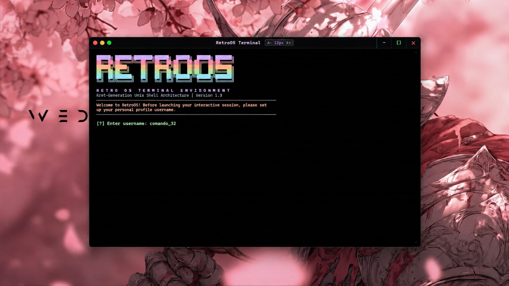
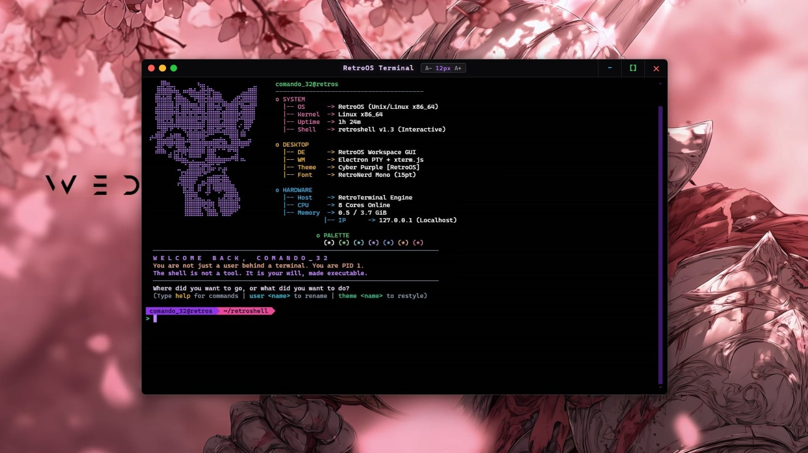

# RetroOS Terminal & retroshell

<div align="center">


**A Next-Generation Unix/Linux Shell & Cyberpunk Desktop Terminal Environment**  
*Precision Braille Halftone Art • Custom User Profiles • Real-time System Analytics • Interactive Process Scheduler*

</div>

---

## Screenshots Showcase

<div align="center">

### Page 1: First-Time Onboarding & Profile Setup
> *When your friend runs RetroOS for the first time, they are welcomed by the RetroOS banner and prompted to create their custom shell username.*



---

### Page 2: Interactive Cyber Purple Fastfetch Shell
> *Instant transition to the interactive session featuring the 18-line Braille Cyber Purple Cat, live system analytics tree, and powerline prompt.*



</div>

---

## Features at a Glance

- **Personalized User Identity (`username@retros`)**
  - First-time interactive setup creates a personalized environment file (`~/.retroshell_user`).
  - Type `welcome` anytime to revisit Page 1 for screenshots or reconfiguring.
  - Type `user <new_name>` to instantly rename your prompt.
- **Vibrant Cyber Purple Fastfetch Art**
  - Handcrafted 18-line Braille halftone character in vibrant Cyber Purple (`#c084fc`).
  - Tree-structured system analytics: OS, Kernel, Live Uptime, CPU Cores, RAM consumption, and 7-swatch color palette.
- **Desktop Terminal GUI (Electron + xterm.js)**
  - Pitch black OLED canvas (`#000000`).
  - Sleek custom titlebar with Sky Cyan (`−`), Emerald Green (`[ ]`), and Rose Red (`✕`) window buttons.
  - **Dynamic Font Zoom**: Interactive `[A-] 15px [A+]` titlebar badge, `Ctrl + =` / `Ctrl + -` / `Ctrl + 0` keyboard shortcuts, and `Ctrl + MouseWheel` zoom.
- **Operating System Core Emulation**
  - Pipelines (`cmd1 | cmd2 | cmd3`), background processes (`&`), file redirection (`<`, `>`, `>>`).
  - Real OS CPU Process Scheduler (`sched fcfs`, `sched real rr`) with live Gantt chart generation.
  - Live system resource and process monitor dashboard (`monitor`).
  - CPU privilege escalation switcher (`mode-switch`: Ring 3 User ⟷ Ring 0 Kernel).

---

## Getting Started (Step-by-Step Guide)

Share these easy steps with any friend who wants to test RetroOS!

### Method A: Running the C Shell directly (Linux / Ubuntu / Debian / WSL)

If your friend has a Linux terminal or Windows Subsystem for Linux (WSL):

#### 1. Clone the repository
```bash
git clone https://github.com/SaKin32/RetroOS_Shell.git
cd retroos-terminal
```

#### 2. Install build dependencies (if needed)
```bash
# On Ubuntu / Debian / WSL:
sudo apt update && sudo apt install -y build-essential gcc make
```

#### 3. Compile and Run
```bash
make
./retroshell
```

---

### Method B: Running the Full Desktop GUI App (Windows / macOS / Linux)

To run the complete windowed terminal with the custom titlebar and font zoom:

#### 1. Prerequisites
- [Node.js](https://nodejs.org/) (Version 18 or newer recommended).

#### 2. Install Dependencies & Launch
```bash
# Clone the repository
git clone https://github.com/SaKin32/RetroOS_Shell.git
cd retroos-terminal

# Install dependencies (only required once)
npm install

# Start the application
npm start
```

---

## What Your Friend Will Experience

1. **Step 1 (First Launch):** The terminal greets them with the RetroOS block logo:
   ```text
     [?] Enter username: 
   ```
   They can type their own name (e.g., `comando_32`).
2. **Step 2 (The Shell Session):**
   The screen clears to **Page 2** displaying the Cyber Purple Cat, the live hardware and OS specs, and their new prompt:
   ```text
    comando_32@retros  ~/retroos-terminal  >
   ```
3. **Step 3 (Returning to the Welcome Screen):**
   If users want to return to the welcome screen, they can simply type:
   ```bash
   welcome
   ```
   This command immediately displays the welcome screen. Pressing Enter allows users to return to the shell smoothly.

---

## 🛠️ Built-in Commands Reference

| Command | Usage | Description |
| :--- | :--- | :--- |
| `welcome` | `welcome` | Opens Welcome & Setup screen (press Enter to return) |
| `user` | `user [name]` | View or change your `@retros` identity |
| `theme` | `theme <cyber\|dracula\|matrix\|retro>` | Switch terminal accent theme colors |
| `monitor` | `monitor [sec]` | Real-time CPU, RAM and process monitoring dashboard |
| `sched` | `sched fcfs 0:5 1:3 2:8` | Run FCFS CPU scheduling algorithm with ASCII Gantt chart |
| `sched real` | `sched real rr 0.5 "burn 2" "burn 1"` | Real process scheduling benchmark with live preemption |
| `mode-switch` | `mode-switch` | Toggle simulated Ring 3 User and Ring 0 Kernel modes |
| `clear` | `clear` | Clear terminal display |
| `help` | `help` | Display list of all shell built-in commands |
| `exit` | `exit` | Gracefully shut down retroshell session |

---

## ⌨️ Desktop GUI Shortcuts

- **Zoom In**: `Ctrl` + `+` (or `Ctrl` + `=`)
- **Zoom Out**: `Ctrl` + `-`
- **Reset Zoom**: `Ctrl` + `0`
- **Mouse Zoom**: `Ctrl` + `Mouse Wheel Up / Down`
- **Clickable Titlebar Badge**: Click `[A-]` or `[A+]` on the top-right of the window.

---

## Project Structure

```text
retroos-terminal/
├── retroshell.c       # Core C shell (lexer, parser, job control, fastfetch)
├── Makefile           # C compilation rules
├── main.js            # Electron window manager and node-pty connector
├── index.html         # Frontend GUI, xterm.js terminal, titlebar & zoom controls
├── fonts/             # Nerd fonts for powerline glyphs and terminal rendering
├── screenshots/       # Screenshots for README showcase
└── package.json       # Electron dependencies and startup scripts
```

---

## Contributing & License

Contributions, bug reports and pull requests are warmly welcomed!  
